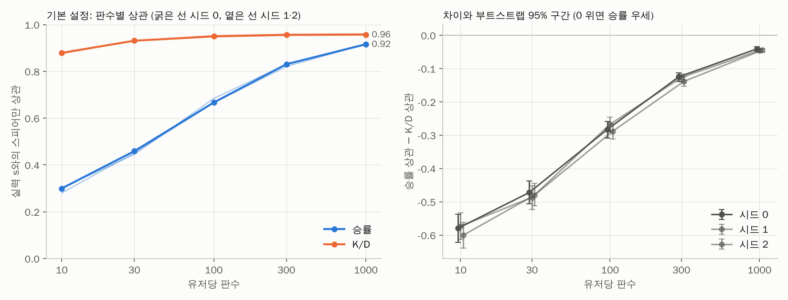
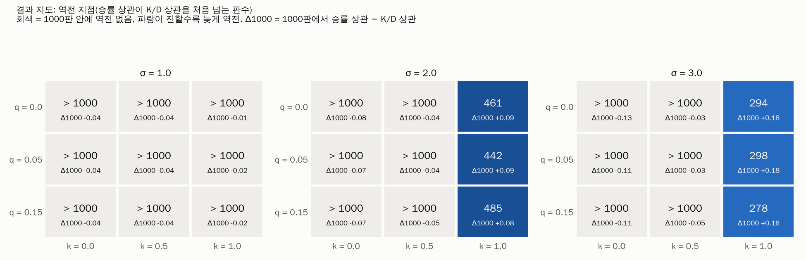

# 본 실행 결과

유저 2000명 × 1000판, 34회 (격자 27 + 기본 시드 2 + 변형 5). 부트스트랩 1000회.

## 1. 기본 설정 판수별 상관

**base_seed0** (역전 지점 > 1000)

| games | rho_winrate | rho_kd | diff | lo | hi |
|---|---|---|---|---|---|
| 10 | 0.300 | 0.879 | -0.579 | -0.622 | -0.537 |
| 30 | 0.459 | 0.931 | -0.472 | -0.506 | -0.437 |
| 100 | 0.667 | 0.950 | -0.282 | -0.308 | -0.259 |
| 300 | 0.831 | 0.956 | -0.125 | -0.139 | -0.113 |
| 1000 | 0.916 | 0.957 | -0.041 | -0.047 | -0.035 |

**base_seed1** (역전 지점 > 1000)

| games | rho_winrate | rho_kd | diff | lo | hi |
|---|---|---|---|---|---|
| 10 | 0.302 | 0.875 | -0.573 | -0.613 | -0.533 |
| 30 | 0.445 | 0.932 | -0.487 | -0.523 | -0.451 |
| 100 | 0.685 | 0.952 | -0.267 | -0.290 | -0.246 |
| 300 | 0.830 | 0.957 | -0.127 | -0.140 | -0.115 |
| 1000 | 0.914 | 0.959 | -0.046 | -0.052 | -0.040 |

**base_seed2** (역전 지점 > 1000)

| games | rho_winrate | rho_kd | diff | lo | hi |
|---|---|---|---|---|---|
| 10 | 0.281 | 0.881 | -0.600 | -0.638 | -0.561 |
| 30 | 0.451 | 0.931 | -0.480 | -0.512 | -0.445 |
| 100 | 0.665 | 0.954 | -0.289 | -0.312 | -0.266 |
| 300 | 0.821 | 0.960 | -0.139 | -0.153 | -0.124 |
| 1000 | 0.916 | 0.961 | -0.045 | -0.051 | -0.040 |

## 2. 결과 지도

| q | k | sigma | crossover | diff_100 | diff_1000 | diff_1000_lo | diff_1000_hi | rho_winrate_1000 | rho_kd_1000 |
|---|---|---|---|---|---|---|---|---|---|
| 0.000 | 0.000 | 1.000 | > 1000 | -0.290 | -0.043 | -0.047 | -0.039 | 0.956 | 0.999 |
| 0.000 | 0.000 | 2.000 | > 1000 | -0.402 | -0.081 | -0.090 | -0.074 | 0.916 | 0.997 |
| 0.000 | 0.000 | 3.000 | > 1000 | -0.502 | -0.131 | -0.143 | -0.119 | 0.864 | 0.994 |
| 0.000 | 0.500 | 1.000 | > 1000 | -0.301 | -0.044 | -0.050 | -0.039 | 0.937 | 0.981 |
| 0.000 | 0.500 | 2.000 | > 1000 | -0.350 | -0.045 | -0.053 | -0.037 | 0.896 | 0.941 |
| 0.000 | 0.500 | 3.000 | > 1000 | -0.368 | -0.029 | -0.043 | -0.017 | 0.854 | 0.883 |
| 0.000 | 1.000 | 1.000 | > 1000 | -0.266 | -0.011 | -0.019 | -0.001 | 0.906 | 0.917 |
| 0.000 | 1.000 | 2.000 | 461 | -0.223 | 0.093 | 0.076 | 0.111 | 0.867 | 0.774 |
| 0.000 | 1.000 | 3.000 | 294 | -0.183 | 0.179 | 0.153 | 0.207 | 0.806 | 0.627 |
| 0.050 | 0.000 | 1.000 | > 1000 | -0.288 | -0.039 | -0.045 | -0.035 | 0.934 | 0.974 |
| 0.050 | 0.000 | 2.000 | > 1000 | -0.400 | -0.071 | -0.079 | -0.063 | 0.901 | 0.972 |
| 0.050 | 0.000 | 3.000 | > 1000 | -0.489 | -0.115 | -0.128 | -0.104 | 0.855 | 0.970 |
| 0.050 | 0.500 | 1.000 | > 1000 | -0.282 | -0.041 | -0.047 | -0.035 | 0.916 | 0.957 |
| 0.050 | 0.500 | 2.000 | > 1000 | -0.326 | -0.043 | -0.053 | -0.033 | 0.877 | 0.921 |
| 0.050 | 0.500 | 3.000 | > 1000 | -0.387 | -0.034 | -0.048 | -0.019 | 0.828 | 0.861 |
| 0.050 | 1.000 | 1.000 | > 1000 | -0.256 | -0.016 | -0.026 | -0.005 | 0.879 | 0.895 |
| 0.050 | 1.000 | 2.000 | 442 | -0.205 | 0.090 | 0.074 | 0.109 | 0.847 | 0.757 |
| 0.050 | 1.000 | 3.000 | 298 | -0.176 | 0.179 | 0.153 | 0.207 | 0.794 | 0.615 |
| 0.150 | 0.000 | 1.000 | > 1000 | -0.260 | -0.038 | -0.044 | -0.032 | 0.885 | 0.923 |
| 0.150 | 0.000 | 2.000 | > 1000 | -0.347 | -0.067 | -0.076 | -0.058 | 0.855 | 0.922 |
| 0.150 | 0.000 | 3.000 | > 1000 | -0.433 | -0.109 | -0.123 | -0.096 | 0.811 | 0.920 |
| 0.150 | 0.500 | 1.000 | > 1000 | -0.287 | -0.040 | -0.048 | -0.032 | 0.870 | 0.909 |
| 0.150 | 0.500 | 2.000 | > 1000 | -0.308 | -0.046 | -0.058 | -0.034 | 0.831 | 0.877 |
| 0.150 | 0.500 | 3.000 | > 1000 | -0.364 | -0.046 | -0.063 | -0.029 | 0.783 | 0.830 |
| 0.150 | 1.000 | 1.000 | > 1000 | -0.267 | -0.017 | -0.029 | -0.005 | 0.840 | 0.858 |
| 0.150 | 1.000 | 2.000 | 485 | -0.203 | 0.079 | 0.060 | 0.098 | 0.813 | 0.734 |
| 0.150 | 1.000 | 3.000 | 278 | -0.195 | 0.163 | 0.134 | 0.192 | 0.762 | 0.599 |

## 3. 스타일별 평균 승률·K/D

기본 설정, 1000판, 시드 3개 평균:

| style | users | winrate | kd_mean | kd_pooled |
|---|---|---|---|---|
| assault | 659 | 0.502 | 1.234 | 0.884 |
| allround | 658 | 0.500 | 1.483 | 1.014 |
| sniper | 682 | 0.498 | 1.951 | 1.186 |

k별 (q = 0.05, σ = 1):

| style | users | winrate | kd_mean | kd_pooled | k |
|---|---|---|---|---|---|
| assault | 662 | 0.505 | 1.622 | 1.083 | 0.000 |
| allround | 682 | 0.499 | 1.436 | 0.993 | 0.000 |
| sniper | 656 | 0.496 | 1.322 | 0.928 | 0.000 |
| assault | 675 | 0.502 | 1.207 | 0.883 | 0.500 |
| allround | 621 | 0.501 | 1.466 | 1.032 | 0.500 |
| sniper | 704 | 0.497 | 1.764 | 1.164 | 0.500 |
| assault | 662 | 0.508 | 1.162 | 0.842 | 1.000 |
| allround | 682 | 0.495 | 1.437 | 0.996 | 1.000 |
| sniper | 656 | 0.498 | 2.375 | 1.590 | 1.000 |

## 4. 보정 보고

| key | assault_capture | sniper_capture | wr_assault | wr_allround | wr_sniper | kd_assault | kd_allround | kd_sniper | ok |
|---|---|---|---|---|---|---|---|---|---|
| base:k=0.5 | 0.5601 | 0.4754 | 0.4998 | 0.4995 | 0.5007 | 0.8450 | 1.0239 | 1.2942 | True |
| base:k=1.0 | 0.6285 | 0.4854 | 0.5026 | 0.4987 | 0.4985 | 0.7556 | 1.0710 | 1.9213 | True |
| kill35:k=0.5 | 0.5158 | 0.4950 | 0.4999 | 0.5005 | 0.4996 | 0.8531 | 1.0317 | 1.3038 | True |
| kill69:k=0.5 | 0.5810 | 0.4597 | 0.4987 | 0.4999 | 0.5016 | 0.8434 | 1.0190 | 1.2842 | True |
| no_ambush:k=0.5 | 0.5604 | 0.4786 | 0.4991 | 0.5000 | 0.5009 | 0.8241 | 1.0270 | 1.3680 | True |
| one_life:k=0.5 | 0.7500 | 0.3000 | 0.4996 | 0.4992 | 0.5013 | 0.8295 | 0.9958 | 1.2553 | True |

## 5. 실행 시간

코어 4개 병렬. 보정 154초, 본 실행 179초, 합계 333초.

## 변형 (기본 설정, 시드 0)

| 변형 | 킬 몫 | 역전 지점 | 승률/KD 10판 | 승률/KD 100판 | 승률/KD 1000판 | Δ1000 [95%] | 인원 열세 역전승 | 티켓 역전승 |
|---|---|---|---|---|---|---|---|---|
| 기본 (킬 62%) | 0.612 | > 1000 | 0.300 / 0.879 | 0.667 / 0.950 | 0.916 / 0.957 | -0.041 [-0.047, -0.035] | 0.000 | 0.040 |
| c = 0.83 (킬 69%) | 0.688 | > 1000 | 0.308 / 0.887 | 0.687 / 0.953 | 0.917 / 0.958 | -0.042 [-0.048, -0.035] | 0.001 | 0.023 |
| c = 12.504 (킬 35%) | 0.353 | > 1000 | 0.203 / 0.811 | 0.528 / 0.942 | 0.844 / 0.955 | -0.111 [-0.123, -0.101] | 0.000 | 0.084 |
| 기습 없음 | 0.610 | > 1000 | 0.313 / 0.878 | 0.665 / 0.944 | 0.903 / 0.949 | -0.046 [-0.053, -0.040] | 0.000 | 0.040 |
| 목숨 1 | 0.377 | > 1000 | 0.253 / 0.814 | 0.581 / 0.947 | 0.864 / 0.962 | -0.098 [-0.110, -0.087] | 0.049 | 0.149 |
| 킬 스틸 0.3 | 0.612 | > 1000 | 0.300 / 0.822 | 0.667 / 0.913 | 0.916 / 0.925 | -0.009 [-0.015, -0.002] | 0.000 | 0.040 |

## 이상치 (기본 설정 시드 0, 각 상위 5 — 전체 20건은 runs/base_seed0/outliers.csv)

**kd_bubble**

| user | s | e | style | winrate | kd | kills | deaths | rank_gap_kd | rank_gap_winrate |
|---|---|---|---|---|---|---|---|---|---|
| 1044 | -0.495 | 1.000 | sniper | 0.552 | 1.875 | 1579 | 842 | 0.458 | 0.512 |
| 551 | -0.504 | 1.000 | sniper | 0.514 | 1.820 | 1538 | 845 | 0.450 | 0.301 |
| 713 | -0.947 | 1.000 | sniper | 0.507 | 1.278 | 1327 | 1038 | 0.443 | 0.391 |
| 1673 | -0.789 | 1.000 | sniper | 0.517 | 1.395 | 1321 | 947 | 0.442 | 0.417 |
| 1282 | -0.465 | 1.000 | sniper | 0.489 | 1.821 | 1562 | 858 | 0.436 | 0.106 |

**kd_hidden_master**

| user | s | e | style | winrate | kd | kills | deaths | rank_gap_kd | rank_gap_winrate |
|---|---|---|---|---|---|---|---|---|---|
| 858 | 0.535 | -1.000 | assault | 0.457 | 0.498 | 1072 | 2152 | -0.453 | -0.493 |
| 1196 | 0.738 | -1.000 | assault | 0.476 | 0.619 | 1263 | 2039 | -0.440 | -0.426 |
| 1850 | 0.512 | -1.000 | assault | 0.443 | 0.510 | 1111 | 2177 | -0.435 | -0.566 |
| 1549 | 0.489 | -1.000 | allround | 0.460 | 0.514 | 911 | 1773 | -0.427 | -0.457 |
| 474 | 0.161 | -1.000 | assault | 0.456 | 0.349 | 804 | 2303 | -0.415 | -0.357 |

**winrate_bubble**

| user | s | e | style | winrate | kd | kills | deaths | rank_gap_kd | rank_gap_winrate |
|---|---|---|---|---|---|---|---|---|---|
| 1835 | -0.677 | 1.000 | assault | 0.549 | 1.084 | 1897 | 1750 | 0.302 | 0.558 |
| 1044 | -0.495 | 1.000 | sniper | 0.552 | 1.875 | 1579 | 842 | 0.458 | 0.512 |
| 862 | -0.484 | 1.000 | assault | 0.548 | 1.234 | 2104 | 1705 | 0.285 | 0.485 |
| 540 | -0.279 | 1.000 | sniper | 0.561 | 2.143 | 1648 | 769 | 0.405 | 0.464 |
| 1010 | -0.077 | 1.000 | assault | 0.586 | 1.784 | 2484 | 1392 | 0.282 | 0.458 |

**winrate_hidden_master**

| user | s | e | style | winrate | kd | kills | deaths | rank_gap_kd | rank_gap_winrate |
|---|---|---|---|---|---|---|---|---|---|
| 1850 | 0.512 | -1.000 | assault | 0.443 | 0.510 | 1111 | 2177 | -0.435 | -0.566 |
| 858 | 0.535 | -1.000 | assault | 0.457 | 0.498 | 1072 | 2152 | -0.453 | -0.493 |
| 1955 | 1.268 | -1.000 | assault | 0.487 | 0.985 | 1816 | 1844 | -0.384 | -0.474 |
| 1549 | 0.489 | -1.000 | allround | 0.460 | 0.514 | 911 | 1773 | -0.427 | -0.457 |
| 761 | 1.134 | -1.000 | allround | 0.487 | 1.056 | 1483 | 1405 | -0.324 | -0.447 |

**game_max_kills**

| s | e | style | game | max_kills | max_kills_user | turns |
|---|---|---|---|---|---|---|
| 1.859 | 0.000 | assault | 27533 | 15 | 1556 | 123 |
| 2.600 | 0.000 | assault | 57054 | 15 | 1615 | 105 |
| 1.542 | 0.000 | assault | 7892 | 14 | 1235 | 114 |
| 2.328 | 0.000 | allround | 8027 | 14 | 1294 | 131 |
| 1.298 | 0.000 | assault | 17255 | 14 | 514 | 122 |

**game_longest**

| game | turns | reason | tickets_a | tickets_b |
|---|---|---|---|---|
| 39446 | 150 | 2 | 3.454 | 0.762 |
| 54273 | 150 | 2 | 5.688 | 0.811 |
| 3852 | 149 | 0 | -3.205 | 1.401 |
| 34813 | 147 | 0 | -1.952 | 3.147 |
| 37111 | 146 | 0 | 17.985 | -0.506 |

**game_ticket_comeback**

| game | turns | tickets_a | tickets_b | winner_max_deficit |
|---|---|---|---|---|
| 24844 | 81 | 0.444 | -0.435 | 68 |
| 39410 | 83 | 6.819 | -1.337 | 67 |
| 4006 | 103 | 3.265 | -1.858 | 61 |
| 33816 | 82 | -2.206 | 0.208 | 60 |
| 11023 | 87 | -1.429 | -0.500 | 60 |

**game_outnumbered**

| user | s | e | style | game | turns | carry_kills | max_alive_deficit |
|---|---|---|---|---|---|---|---|
| 270 | 2.756 | 0.000 | allround | 7581 | 87 | 5 | 5 |
| 705 | 0.481 | 0.000 | assault | 37994 | 98 | 4 | 5 |
| 1414 | 1.062 | 0.000 | allround | 40010 | 77 | 6 | 5 |
| 441 | 1.060 | 0.000 | assault | 43325 | 93 | 6 | 5 |
| 884 | 0.669 | 0.000 | assault | 47280 | 94 | 5 | 5 |

## 인원 열세 역전승 캐리 (실행별)

| run | n | s_mean | e_mean | kills_mean |
|---|---|---|---|---|
| base_seed0 | 10 | 1.074 | 0.000 | 5.200 |
| base_seed1 | 15 | 0.619 | 0.133 | 4.800 |
| base_seed2 | 14 | 1.207 | 0.000 | 4.286 |
| kill69 | 77 | 1.279 | 0.000 | 5.844 |
| no_ambush | 16 | 0.847 | 0.000 | 4.375 |
| one_life | 3092 | 1.420 | 0.065 | 5.882 |
| q0.05_k0.0_s1.0 | 5 | 1.002 | 0.000 | 5.000 |
| q0.05_k0.0_s2.0 | 8 | 0.476 | 0.000 | 4.500 |
| q0.05_k0.0_s3.0 | 12 | 0.383 | 0.000 | 4.500 |
| q0.05_k0.5_s2.0 | 20 | 0.576 | 0.100 | 4.150 |
| q0.05_k0.5_s3.0 | 12 | 0.687 | 0.000 | 4.333 |
| q0.05_k1.0_s1.0 | 29 | 1.093 | 0.034 | 4.828 |
| q0.05_k1.0_s2.0 | 41 | 0.643 | -0.024 | 4.073 |
| q0.05_k1.0_s3.0 | 28 | 0.480 | 0.000 | 3.750 |
| q0.0_k0.0_s1.0 | 8 | 1.102 | 0.000 | 5.750 |
| q0.0_k0.0_s2.0 | 7 | 1.012 | 0.000 | 5.286 |
| q0.0_k0.0_s3.0 | 7 | 0.563 | 0.000 | 4.857 |
| q0.0_k0.5_s1.0 | 11 | 0.770 | 0.000 | 4.455 |
| q0.0_k0.5_s2.0 | 17 | 0.900 | 0.000 | 4.412 |
| q0.0_k0.5_s3.0 | 13 | 0.961 | 0.000 | 4.462 |
| q0.0_k1.0_s1.0 | 29 | 0.633 | 0.000 | 4.586 |
| q0.0_k1.0_s2.0 | 33 | 0.578 | 0.000 | 3.909 |
| q0.0_k1.0_s3.0 | 43 | 0.537 | 0.000 | 4.023 |
| q0.15_k0.0_s1.0 | 6 | 0.847 | 0.000 | 5.333 |
| q0.15_k0.0_s2.0 | 8 | 0.913 | 0.125 | 4.750 |
| q0.15_k0.0_s3.0 | 11 | 0.398 | 0.273 | 4.455 |
| q0.15_k0.5_s1.0 | 12 | 0.687 | 0.167 | 4.750 |
| q0.15_k0.5_s2.0 | 13 | 0.712 | 0.077 | 4.308 |
| q0.15_k0.5_s3.0 | 18 | 0.914 | 0.000 | 4.222 |
| q0.15_k1.0_s1.0 | 26 | 0.760 | 0.154 | 4.269 |
| q0.15_k1.0_s2.0 | 43 | 0.764 | 0.186 | 4.233 |
| q0.15_k1.0_s3.0 | 42 | 0.457 | 0.095 | 3.857 |
| steal30 | 10 | 0.452 | 0.100 | 4.000 |
